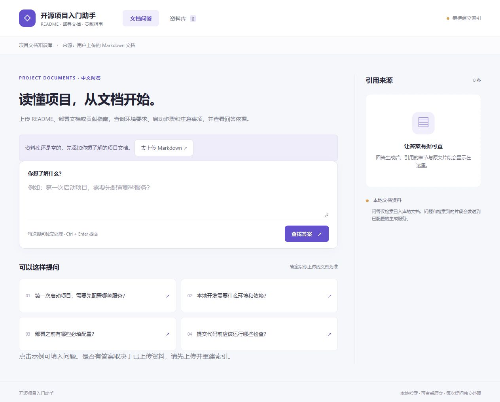

# 开源项目入门助手

面向项目文档的中文 RAG 问答应用。上传 README、部署文档或贡献指南，查询环境要求、启动步骤与注意事项，并通过引用查看原文。

**默认资料库为空，支持任意项目的 UTF-8 Markdown。** 正常使用只需“上传文档 → 重建索引 → 提问”，不需要创建产品目录、改项目名称或修改检索代码。选取的开源文档仅作为独立测试资料，应用启动不依赖它们。



## 技术栈

| 部分 | 技术 |
|---|---|
| 后端 | Python 3.12、FastAPI、Pydantic |
| 前端 | Vue 3、TypeScript、Vite |
| 向量化 | sentence-transformers、BAAI/bge-small-zh-v1.5，默认 CPU |
| 存储 | SQLite 保存正文、元数据与父子关系；Chroma 持久化子块向量 |
| 混合检索 | jieba、rank-bm25；RRF 融合向量与关键词排序 |
| 生成模型 | 可配置的 OpenAI 兼容 Chat Completions 服务 |
| 原文显示 | markdown-it、DOMPurify，禁用原始 HTML 执行 |

后端依赖见 [requirements.txt](backend/requirements.txt) 和完整版本文件 [requirements.lock.txt](backend/requirements.lock.txt)，前端依赖由 `package-lock.json` 锁定。

## 本地部署（Windows）

准备 Python 3.12 和 Node.js 22，在项目根目录打开 PowerShell：

```powershell
git clone https://github.com/jame111111/project-docs-rag.git
cd project-docs-rag
py -3.12 -m venv .venv
.\.venv\Scripts\python.exe -m pip install -r backend\requirements.lock.txt
npm --prefix frontend ci
if (-not (Test-Path backend\.env)) {
    Copy-Item backend\.env.example backend\.env
}
```

编辑 `backend/.env`：

- 首次下载向量模型时设置 `EMBEDDING_LOCAL_ONLY=false`；下载成功后可改回 `true`。也可用 `EMBEDDING_MODEL` 指定已下载的本地模型目录。
- 真实问答填写 `LLM_BASE_URL`、`LLM_API_KEY`、`LLM_MODEL`，服务需支持 JSON 对象输出。密钥只在后端读取。
- `DATA_DIR` 默认是 `data/runtime/knowledge-base`，保存上传资料和本地索引。无需填写 `PRODUCT_CONFIG`。

在两个 PowerShell 终端分别启动：

```powershell
.\scripts\start-backend.ps1
```

```powershell
.\scripts\start-frontend.ps1
```

打开 [前端](http://127.0.0.1:5173/)；[接口文档](http://127.0.0.1:8000/docs)。在“资料库”上传 `.md` 文件，全部上传后点击“重建索引”。成功后进入“文档问答”。无需先运行 CLI 导入示例资料。

仅接受 UTF-8 Markdown，单个文件最多 1 MB。系统自动规范化、解析章节和分块。同名 README 可分别上传；替换已有文档时点击该行“更新”，按内部文档 ID 更新，再重建索引。更新后旧索引不可用于问答，重建失败也会明确显示不可用。历史答案应重新提问，当前未保存历史正文版本。

没有模型配置时，上传、阅读、建立索引和检索评测仍可用；真实问答显示配置提示。检索在本地进行，问题和检索片段会发送到配置的生成模型服务。

## 流程与模块

`Markdown → 规范化正文 → 章节父块 → 父块内子块 → 子块向量与 BM25 → RRF → 回补父块 → 模型结构化回答 → 引用检查 → 原文定位`

子块用于匹配具体命令和问题，父块补充同章节中的步骤、前置条件和注意事项。默认两路各取 10 个候选，保留前 5 个子块，最多使用 3 个去重父块；上下文预算为 4000 字符，放不下的完整块会跳过，继续检查剩余命中。不截断章节、不扩大 top_k；父块增加上下文成本，也可能因数量限制漏掉其他章节。

BM25 使用中文分词，过滤标点和常见虚词，保留 `C++`、`docker-compose`、变量名等技术标识符；向量检索补充语义匹配，RRF 融合排名。是否改善效果需要针对实际文档评测。索引指纹包含正文、模型配置与分词算法版本，版本变化会在启动时提示重建。引用检查只核对编号和连续原文是否真实存在，不能证明答案正确；没有有效引用时按依据不足处理，模型运行错误单独报告。

| 模块 | 职责 |
|---|---|
| `documents.py`、`chunking.py` | 正文规范化、结构分块、字符偏移 |
| `storage.py`、`indexing.py` | SQLite、Chroma、父子关系、索引状态与 BM25 缓存 |
| `retrieval.py`、`answering.py` | 双路检索、上下文、模型调用与引用检查 |
| `api.py` | 文档上传/更新、正文、索引、问答 REST 接口 |
| `config.py`、`products.py`、`cli.py` | 后端配置和可选的批量快照导入；普通上传不需使用 CLI |
| `frontend/src/pages`、`components` | 两个页面及安全原文阅读面板 |
| `evaluation/fixtures`、`evaluation/results` | 独立测试文档、固定题集和实际评测结果 |
| `backend/tests` | 离线流程测试及隔离浏览器测试服务 |

接口：`GET /api/health`、`GET /api/examples`、`GET /api/documents`、`GET /api/documents/{id}`、`POST /api/documents`、`PUT /api/documents/{id}`、`POST /api/index/rebuild`、`POST /api/ask`。公开字段不含服务器文件路径。

## 评测与验证

主要测试集选取20个 GitHub 项目的固定 README，每项目30道中文题，共600题（480道有依据、120道无依据）。每个项目独立索引，正例来自240组事实各两种措辞。来源提交号、许可、参考要点和证据位置见 [测试集说明](evaluation/github_readmes/README.md)。文档仅用于测试，不会自动导入正式资料库；参考答案和负例的独立人工复核尚未完成。

```powershell
.\scripts\evaluate-github-readmes.ps1 -Phase retrieval
.\scripts\evaluate-github-readmes.ps1 -Phase answers
```

评测命令使用独立的 `data/runtime/github-readmes-v2`，首次运行从本地快照建立索引。三模式共享语料与子块：纯向量子块、混合检索子块、混合检索父块，均报告 `top_k=1/5`，每次结果保存到新的 JSON/CSV 目录。真实生成评测保存答案、引用和 `answers-review.csv`，人工核对后才能统计正确性及拒答指标。

本轮先使用440道开发题检查预算处理与分词改动，冻结实现后完成600题、3,600条真实 CPU BGE 检索对照。**题目已在基线测试中查看，这是一轮回归测试，新题泛化尚未验证。** 默认 `top_k=5` 的完整证据覆盖率：

| 模式 | 改动前 | 当前 | 当前完整覆盖/480 |
|---|---:|---:|---:|
| 纯向量子块 | 52.29% | 52.29% | 251 |
| 混合检索子块 | 51.67% | 53.75% | 258 |
| 混合检索父块 | 64.79% | 67.08% | 322 |

完整覆盖要求全部必需证据进入实际上下文，**不是回答准确率**。保持基线候选不变、只修复预算处理时，父块覆盖从311/480变为315/480，正例空上下文从10题减至3题。新版整体父块覆盖322/480，相对基线改善26题、退步15题；`top_k=1` 父块覆盖反而从42.50%降至42.29%。没有只展示有利配置。

完整 top_k=1/5、逐项目及口语问法数据见 [本轮报告](evaluation/results/github-readmes-improved-2026-10-07/REPORT.md)；改动前后与固定候选的预算对照见 [回归比较](evaluation/results/github-readmes-improved-2026-10-07/comparison.md)，包含三个实际改善/失败案例。保留 [原600题基线](evaluation/results/github-readmes-2026-10-07/REPORT.md) 和 [早期40题结果](evaluation/results/project-docs-2026-10-05/REPORT.md)，不会覆盖历史数据。

本次为中文问题检索英文原文。当前分词没有翻译、口语改写或术语扩展；不可拆的大表格仍可能超过预算，也没有验证多个仓库混库时的误检。重新构建 Chroma 会带来少量近邻顺序差异，完整新版的改善不能全部归因于关键词清理。

早期7文档40题的测试仍可通过 `evaluate-retrieval.ps1`、`evaluate-answers.ps1` 运行，与正式资料库隔离。

已通过 **32项离线流程测试**、前端类型检查和生产构建；浏览器与各轮验证记录见 [verification.json](docs/project-docs/verification.json)。新增回归检查覆盖预算跳过、去重/连续引用编号、技术标识符、旧索引升级失效及无关键词文档。测试可替换向量/模型依赖，浏览器回答夹具有明确标注。当前没有生成模型配置，600条默认模式生成记录未运行，答案正确性、错误章节拒答与真实负例拒答质量尚未验证。

```powershell
.\.venv\Scripts\python.exe -m pytest -q
npm --prefix frontend run build
```

## 范围与 GitHub 交付

仅支持以文字为主的 Markdown。每个问题独立处理；不解析整个代码仓库、不执行部署命令，没有 PDF/OCR、多轮记忆、登录和权限管理。适合本地单进程演示。当前中文向量模型在英文资料上的表现需要进一步验证。

`.gitignore` 排除了密钥、用户上传、运行时索引、缓存与历史场景语料。测试文档保留上游许可证。运行下面的命令可核对候选文件并生成源码包，命令不推送远程仓库：

```powershell
.\.venv\Scripts\python.exe scripts\package_github.py
```

输出 `artifacts/project-docs-assistant-github.zip`，包含源码、固定测试资料、评测结果和使用文档。

可用于简历的已验证实现描述：

- 使用 FastAPI、Vue 3、SQLite 和 Chroma 实现 Markdown 文档上传、更新、索引与引用定位流程，通过32项离线流程测试和前端构建。
- 实现章节父块与段落子块、向量/BM25 双路检索和 RRF 融合，按统一预算回补完整父块上下文。
- 固定20个开源项目的 README 快照及每项目30道中文题，完成600题、3,600条检索回归；修复上下文预算处理并改进分词，默认父块完整证据覆盖由64.79%变为67.08%，同时记录退步案例。
